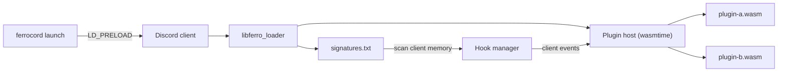

<div align="center">

# 🦀 ferrocord

**A plugin loader for the native, Rust-based Discord client.**

Sandboxed WebAssembly plugins · signature-based hooking · no Electron required

[](https://github.com/Official-OptiNex/ferrocord/actions/workflows/ci.yml)
[](#-license)
[](https://www.rust-lang.org)
[](ROADMAP.md)

[Why](#-why) · [How it works](#-how-it-works) · [Quick start](#-quick-start) · [Writing plugins](#-writing-plugins) · [Roadmap](ROADMAP.md) · [Contributing](CONTRIBUTING.md)

</div>

---

> [!WARNING]
> **ferrocord is in early development.** The native client has not been publicly released yet, so ferrocord
> cannot hook into it today. The core, plugin system and Linux loader work and are tested; client-specific
> hooks will follow once builds are available.

> [!CAUTION]
> Client modifications are against Discord's Terms of Service. Use ferrocord at your own risk. It is an
> independent project and is **not affiliated with, endorsed by, or supported by Discord Inc.**

## ✨ Why

Discord is rebuilding its desktop and mobile apps in Rust, moving away from Electron and React. Today's
client mods work by injecting JavaScript and CSS into an Electron web page, and a native app has neither.

ferrocord is built for the new client from the start:

| | Electron-era mods | ferrocord |
|---|---|---|
| **Injection** | JavaScript in the renderer | Native library loaded into the process |
| **Finding code** | Webpack module search | Byte signatures in the client binary |
| **Plugins** | Unsandboxed JS with full access | **WebAssembly in a sandbox** |
| **Plugin languages** | JavaScript / TypeScript | Rust, C, Zig, AssemblyScript… anything that compiles to WASM |
| **Runaway plugin** | Freezes the client | Stopped by a fuel limit and unloaded |

## 🧩 Features

- 🔍 **Signature scanner**: IDA-style patterns (`48 8B ?? ?? 0F 85`) with wildcards, offsets and ambiguity checks
- 🪝 **Hook manager**: named detours that can be enabled, disabled and removed at runtime
- 📦 **WASM plugin host**: powered by [wasmtime](https://wasmtime.dev), with no file or network access by default
- ⛽ **Fuel limits**: every call into a plugin is capped, so a stuck plugin can't hang Discord
- 🧾 **Updatable signatures**: kept in a plain text file, so the community can fix them after a Discord update without recompiling anything
- 🛡️ **Safe by default**: the loader stays inactive in any process that isn't the Discord client
- 🩺 **`ferrocord doctor`**: checks your setup at a glance

## ⚙️ How it works



1. **`ferrocord launch`** starts the client with the loader library preloaded.
2. The **loader** starts on a background thread and sets up logging.
3. **Plugins** in the plugins folder are compiled and initialised in their own sandboxes.
4. **Signatures** from `signatures.txt` are resolved against the client's executable code.
5. **Hooks** turn client activity into events (`ready`, `message_create`, …) that are sent to plugins.

## 🚀 Quick start

> Linux only for now. Windows and macOS support is [on the roadmap](ROADMAP.md).

```bash
git clone https://github.com/Official-OptiNex/ferrocord
cd ferrocord
cargo build --release
```

Install the example plugin and check your setup:

```bash
./target/release/ferrocord install examples/hello-plugin
./target/release/ferrocord doctor
```

Launch the client:

```bash
./target/release/ferrocord launch /path/to/Discord
```

You should see output like:

```text
ferrocord INFO  ferro_loader: ferrocord v0.1.0 starting in `Discord`
ferrocord INFO  plugin: [hello] hello from a Rust plugin!
ferrocord INFO  ferro_plugin_host: loaded plugin `hello` v0.1.0
ferrocord INFO  plugin: [hello] got event `ready`
```

### Commands

| Command | Description |
|---|---|
| `ferrocord launch <client> [-- args]` | Start the client with ferrocord loaded |
| `ferrocord install <dir>` | Install a plugin folder (`manifest.json` + `plugin.wasm`) |
| `ferrocord doctor` | Check the loader, signatures and installed plugins |
| `ferrocord paths` | Show where data, plugins, signatures and logs live |

### Configuration

| Variable | Default | Purpose |
|---|---|---|
| `FERROCORD_DIR` | `~/.local/share/ferrocord` | Data folder (plugins, signatures, log) |
| `FERROCORD_LOG` | `info` | Log level: `error`, `warn`, `info`, `debug`, `trace` |
| `FERROCORD_LOADER` | next to the `ferrocord` binary | Path to the loader library |

## 🔌 Writing plugins

A plugin is a folder with a `manifest.json` and a `plugin.wasm`:

```json
{
  "id": "hello",
  "name": "Hello",
  "version": "0.1.0",
  "description": "Logs a greeting on startup and every event it receives.",
  "authors": ["you"],
  "api_version": 1
}
```

The plugin exports a few functions and can call back into ferrocord:

```rust
#[no_mangle]
pub extern "C" fn ferro_init() -> i32 {
    ferro::info("hello from a Rust plugin!");
    0 // non-zero = failed to start
}

#[no_mangle]
pub extern "C" fn ferro_on_event(ptr: *mut u8, len: usize) {
    // `ptr..ptr+len` holds the event as JSON, e.g. {"type":"ready", ...}
}
```

Build it for WebAssembly:

```bash
cargo build --release --target wasm32-unknown-unknown
```

See [`examples/hello-plugin`](examples/hello-plugin) for the full source and
[`ferro-plugin-api`](crates/ferro-plugin-api/src/lib.rs) for the ABI reference.

<details>
<summary><b>Plugin ABI v1 reference</b></summary>

| Direction | Name | Signature | Notes |
|---|---|---|---|
| export | `memory` | memory | Required |
| export | `ferro_alloc` | `(len: i32) -> i32` | Returns a buffer for the host to write into |
| export | `ferro_init` | `() -> i32` | Called once; return `0` on success |
| export | `ferro_on_event` | `(ptr: i32, len: i32)` | Optional; receives event JSON |
| import | `ferro.log` | `(level: i32, ptr: i32, len: i32)` | UTF-8 message; levels 1 (error) to 5 (trace) |

</details>

## 🧬 Signatures

Discord ships without debug symbols, so functions are located by byte patterns. Signatures live in
`signatures.txt` in the data folder:

```text
# name            offset  pattern
send_message      0       55 48 89 E5 41 57 ?? ?? 48 83 EC
render_message   -4       0F 85 ?? ?? ?? ?? 48 8B 7D
```

Each signature must match **exactly once**. Missing or ambiguous signatures are logged and skipped, so a
Discord update degrades features instead of crashing the client.

## 🗂️ Project layout

```text
ferrocord/
├── crates/
│   ├── ferro-core/          # scanner, memory regions, signatures, hooks, paths
│   ├── ferro-plugin-api/    # manifest, events and the plugin ABI
│   ├── ferro-plugin-host/   # wasmtime-based sandboxed plugin runtime
│   ├── ferro-loader/        # library injected into the client
│   └── ferro-launcher/      # the `ferrocord` command-line tool
└── examples/
    └── hello-plugin/        # minimal plugin written in Rust
```

## 🛠️ Development

```bash
cargo test --workspace         # run the test suite
cargo clippy --workspace       # lint
cargo fmt --all                # format
```

## 🗺️ Roadmap

The short version: **Linux loader ✅ → Windows & macOS → first real hooks → plugin SDK → themes.**
See [ROADMAP.md](ROADMAP.md) for details.

## 🤝 Contributing

Contributions are welcome, especially signatures for new client builds. Read
[CONTRIBUTING.md](CONTRIBUTING.md) to get started, and see [SECURITY.md](SECURITY.md) to report a
vulnerability privately.

## 📄 License

Licensed under either of

- Apache License, Version 2.0 ([LICENSE-APACHE](LICENSE-APACHE))
- MIT license ([LICENSE-MIT](LICENSE-MIT))

at your option.

Unless you explicitly state otherwise, any contribution intentionally submitted for inclusion in this
project, as defined in the Apache-2.0 license, shall be dual licensed as above, without any additional
terms or conditions.

---

<div align="center">
<sub>Made with 🦀 by Loofary · Not affiliated with Discord Inc.</sub>
</div>
